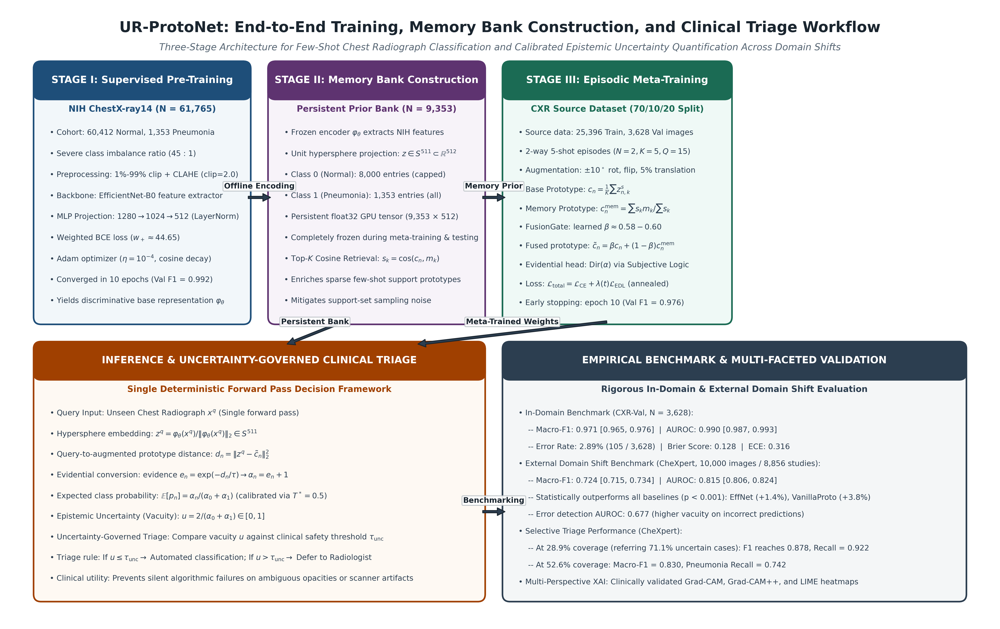

# UR-ProtoNet

**Evidential Retrieval-Augmented Prototypical Networks for Uncertainty-Aware Few-Shot Chest X-Ray Classification Across Domain Shifts**

This repository contains the complete implementation behind the manuscript (revised version, *Intelligence-Based Medicine*, IBMED-D-26-00736). The code covers preprocessing, the three training stages, all baselines and ablations, evaluation under two support protocols, the statistics, and every table and figure of the paper and its supplement.

<p align="center"></p>

## Method in brief

UR-ProtoNet classifies a chest radiograph as Normal or Pneumonia from *K* labeled support images per class.

- **Encoder.** An EfficientNet-B0 backbone with a two-layer projection head to a 512-d, L2-normalized embedding. Stage I pre-trains it on all 14 findings of NIH ChestX-ray14.
- **Labeled memory.** 8,000 Normal and 1,353 Pneumonia NIH embeddings. For each class, the top-5 entries most similar to the episode prototype are retrieved, and their similarity-weighted mean is the memory prototype.
- **FusionGate.** A small MLP on `[c, c_mem]` that outputs a per-class weight β and fuses the two prototypes as `c~ = β c + (1 − β) c_mem`.
- **Evidential head.** Computes `log e_n = (γ − d_n²)/τ` with learned γ and τ, and `α = e + 1`. It yields the probability `E[p] = α/S`, the vacuity `u = 2/S` (bounded by `1/(1+e^{γ/τ}) ≤ u < 1`) and the dissonance `2 min(b_0, b_1)`. For two classes, `u + diss = 2(1 − max E[p])`.
- **Two-step Stage III.**
  1. Episodic meta-training of the encoder and the evidential head (cross-entropy plus annealed KL regularization).
  2. The memory is encoded once with the final encoder, and only the FusionGate is trained on the frozen embeddings.
- **Inference.**
  - Temperature scaling is fitted on CXR-Val.
  - Predictions are ensembled over M = 20 support sets.
  - An optional transductive mode adapts the decision rule to an unlabeled batch from the deployment site (`urproto/tta.py`).

## Main results (10 independent runs, mean ± SD)

| Evaluation set | Support images | Macro-F1 | AUROC | ECE |
|---|---|---|---|---|
| CXR-Test (2,834 images, de-duplicated) | source (CXR-Train) | 0.956 ± 0.004 | 0.994 ± 0.002 | 0.018 |
| CheXpert (8,856 patients) | 5 per class from CheXpert (patient-disjoint) | 0.790 ± 0.010 | 0.862 ± 0.010 | 0.044 |
| CheXpert (8,856 patients) | source (CXR-Train) | 0.670 ± 0.060 | 0.835 ± 0.021 | 0.174 |
| SIIM-FISABIO-RSNA (5,454 studies) | 5 per class from SIIM (study-disjoint) | 0.652 ± 0.059 | 0.850 ± 0.021 | 0.111 |

The comparison with EfficientNet-Binary, VanillaProtoNet, MatchingNet and SimpleShot, the ablations, the memory analyses, the risk–coverage analysis and the transductive mode are reported in the paper. The summary tables are in `paper_results/`.

## Repository structure

```
urproto/          the package
  config.py       all hyperparameters (dataclass Config)
  data.py         dataset tables, de-duplication (dHash, patient, NIH origin), preprocessing, cache, augmentation
  models.py       encoder, memory bank, FusionGate, evidential head, baselines
  train.py        Stage I (binary / multi-label), episodic meta-training, two-step training, supervised baseline
  evaluate.py     support-set ensembles, temperature scaling, metrics
  tta.py          optional transductive inference, evidential uncertainty decomposition
  stats.py        paired t / Wilcoxon tests, Holm, DeLong, bootstrap, risk-coverage, AURC
  xai.py          Grad-CAM, Grad-CAM++, LIME
  jobs.py         command-line entry point for every job
  report.py       tables and figures from the saved predictions
  paper_tables.py, paper_figs.py, supp_tex.py, supp_figs.py   manuscript and supplement tables / figures
assets/           image lists (CXR train/val split, CheXpert query set, CXR images that originate from NIH)
checkpoints/      Stage I encoder and the UR-ProtoNet model of seed 42
paper_results/    summary tables of the 10-run evaluation
```

## Data

All datasets are public Kaggle datasets. The paths are discovered automatically below `/kaggle/input`, or below the directory given in the environment variable `URP_INPUT`.

- NIH ChestX-ray14, 224 × 224 distribution (`khanfashee/nih-chest-x-ray-14-224x224-resized`)
- CXR corpus (`reflex7/cxr-data-set`), which aggregates the Kermany et al. collection and other public sources
- CheXpert-v1.0-small (`ashery/chexpert`)
- SIIM-FISABIO-RSNA COVID-19 detection: images (`xhlulu/siim-covid19-resized-to-224px-png`) and study labels (`surajghuwalewala/siim-covid19-detection-data`)

`assets/` fixes the CXR train/validation split and the 10,000 CheXpert query images. The strict CXR-Val and CXR-Test subsets, the patient-disjoint CheXpert support pool and the SIIM-FISABIO-RSNA pools are derived deterministically by `urproto/data.py`.

## Reproduction

Every job runs on a single 16 GB GPU (the paper used Kaggle T4 sessions).

```bash
# 1. Preprocess and cache all datasets (CPU)
python -m urproto.jobs cache --out out/cache --assets assets
python -m urproto.jobs cache_nih14 --out out/cache_nih14

# 2. Stage I: multi-label NIH pre-training (checkpoint = best held-out mean AUROC)
python -m urproto.jobs stage1 --out out/stage1 \
  --override '{"pre_task": "multilabel", "pre_epochs": 8, "pre_exclude_cxr_eval": true, "pre_logit_scale": 16.0, "pre_aux_head": true}'

# 3. Stage III, all seven methods and the full evaluation, for each seed
python -m urproto.jobs seeds --out out/seeds --seeds 42 123 777 0 999 1 7 13 2024 31337 \
  --override '{"decoupled": true, "aug_mode": "dg"}' \
  --tta '{"tcr": 1.0, "rho": 0.5, "iters": 10, "est_prior": true}'

# 4. Explanations for the seed-42 model
python -m urproto.jobs xai --out out/xai --seeds 42 --lime

# 5. Tables and figures
python -m urproto.report --runs out/seeds --out out/report --stage1 out/stage1 --xai out/xai
python -m urproto.paper_tables --rep out/report --out out/report/tex
python -m urproto.paper_figs --runs out/seeds --out out/report/paper --seed 42
```

Use `--cache` and `--encoder` to point a job to an existing cache or Stage I encoder. One seed of step 3, which covers all methods, both support protocols, the K-shot and the memory analyses, takes about 1.2 h on a T4.

## Checkpoints

- `checkpoints/stage1_encoder.pt` is the Stage I encoder (`state_dict` of `urproto.models.Encoder`).
- `checkpoints/urprotonet_seed42.pt` is the full UR-ProtoNet model of seed 42: `{"state_dict", "T", "cfg"}` for `ProtoModel(Encoder(...), "full", cfg)`, where `T` is the temperature fitted on CXR-Val.

The memory embeddings are recomputed from the NIH images with `urproto.train.build_memory`, as in `jobs.py xai`.

## Citation

If you use this code, please cite the paper (citation details will be added on publication).

## License

MIT, see `LICENSE`.
